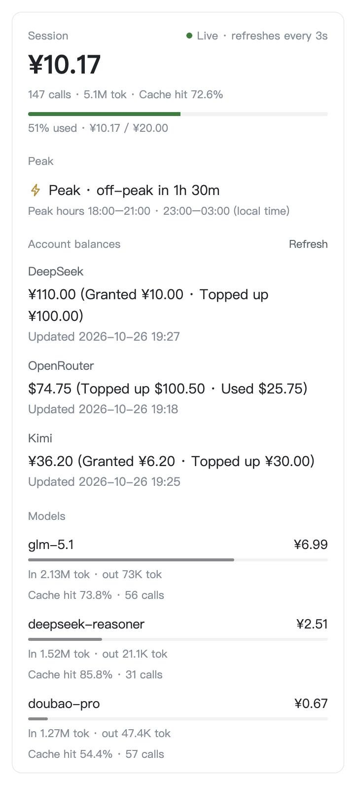
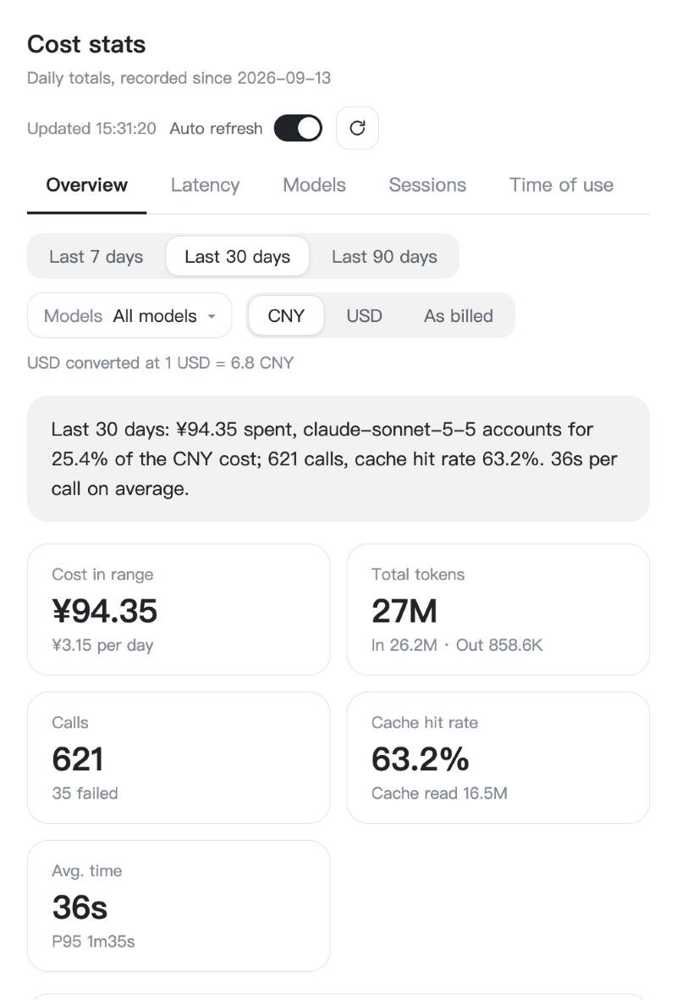
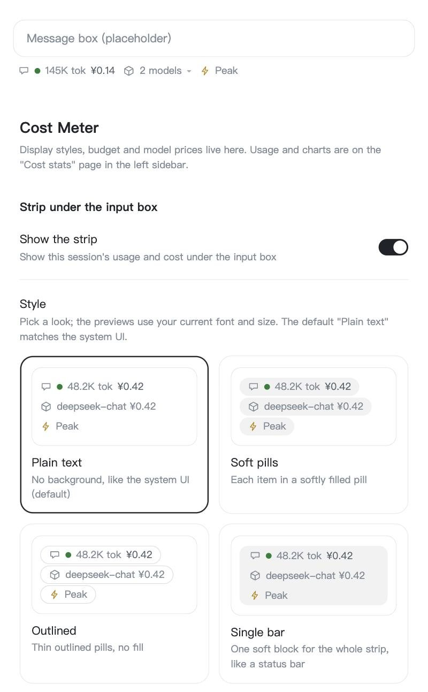
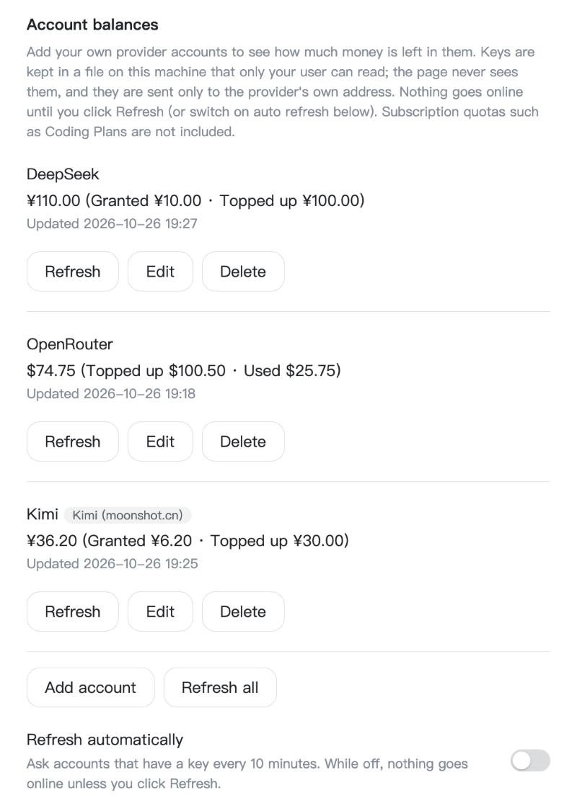
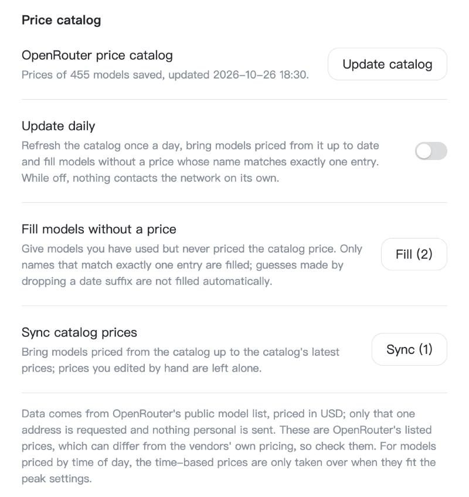
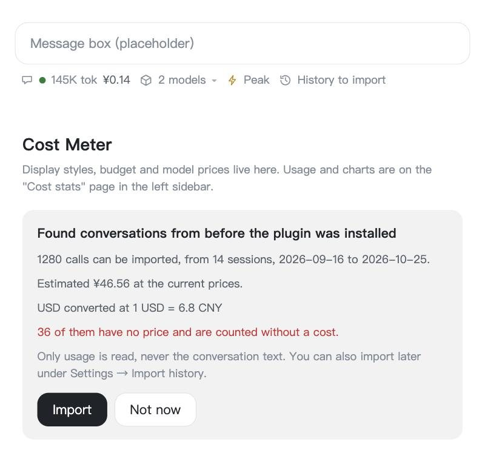

<p align="center">
  
</p>
<h1 align="center">Cost Meter</h1>
<p align="center">
  <strong>Know what every session and every model costs, while you work.</strong><br />
  A DeepSeek Harness plugin that counts tokens and money per session and per model, shows them under the input box and in a live right-sidebar tab, and charts the history on a statistics page. Prices, budgets and display styles are yours to set; everything stays on your machine.
</p>
<p align="center">
  <a href="https://www.npmjs.com/package/@norixor/dsh-cost-meter"></a>
  <a href="#installation-and-quick-start"></a>
  
  
  <a href="#license"></a>
</p>
<p align="center">
  <a href="#installation-and-quick-start">Install</a> ·
  <a href="#key-features">Features</a> ·
  <a href="#preview">Preview</a> ·
  <a href="#languages">Languages</a> ·
  <a href="#development-from-source">Development</a>
</p>
<p align="center">English · <a href="README.zh-CN.md">简体中文</a></p>

## Contents

- [About](#about)
- [Installation and quick start](#installation-and-quick-start)
- [Key features](#key-features)
- [Preview](#preview)
- [How costs are calculated](#how-costs-are-calculated)
- [Image and speech metering (experimental)](#image-and-speech-metering-experimental)
- [Languages](#languages)
- [Data and privacy](#data-and-privacy)
- [Known limitations and status](#known-limitations-and-status)
- [Development from source](#development-from-source)
- [Project layout](#project-layout)
- [License](#license)

## About

A long agent session can burn through tokens across several models, and the bill only shows up later. Cost Meter listens to every model call that DeepSeek Harness (DSH) makes, locks the price in at the moment the call finishes, and keeps the running total next to where you work: under the input box, beside each assistant message, in a side panel that follows the current session, and on a full statistics page. It ships preset prices for 66 models, handles cache read/write pricing, context-length tiers and peak-hour pricing, and works in whatever currency your models bill in.

## Installation and quick start

Cost Meter is published on npm as [`@norixor/dsh-cost-meter`](https://www.npmjs.com/package/@norixor/dsh-cost-meter), and the same package works in both forms of DeepSeek Harness: the desktop app and DSH Web (`dsh web`). Each form keeps its own plugin list (its *profile*), so install it in the one you use, or in both.

**Desktop app**

1. In DeepSeek Harness, open **Plugins** in the left sidebar.
2. Click **Add plugin**, enter the package name `@norixor/dsh-cost-meter` in the **Package name or address** field, and click **Install**.
3. **Restart DeepSeek Harness.**

If the package cannot be found right after a release, open **Registry** in the same dialog and pick **Official npm registry**: a mirror can lag behind npm for a while.

**DSH Web / command line**

```bash
dsh plugin --profile web add @norixor/dsh-cost-meter
```

Then restart `dsh web`.

The left-sidebar statistics page needs a DSH client that supports plugin entries in the left sidebar; the right-sidebar tab needs a client with the right-sidebar page API. On an older client the features that are not available simply do not appear, and everything else keeps working.

To upgrade, uninstall the plugin and add it again. To uninstall: **Plugins →** the plugin **→ Uninstall** (or `dsh plugin --profile web remove @norixor/dsh-cost-meter`), then restart.

### Install from a local folder

Use this to try a checkout or your own changes. **Add plugin** also accepts the absolute path of a local folder (or choose **Install a third-party plugin** from the arrow next to **Add plugin**):

1. `git clone https://github.com/Norixor/dsh-cost-meter.git` and keep the folder in a fixed place, for example `D:\dsh-plugins\dsh-cost-meter` on Windows. A path without spaces or non-ASCII characters is safest.
2. In **Plugins → Add plugin**, enter the folder's absolute path and click **Install**.
3. **Restart DeepSeek Harness.**

A plugin installed from a local folder is linked, not copied: do not move or delete the folder afterwards.

### First steps

1. Start a conversation. A strip appears under the input box: `icon · traffic light · tokens · cost`.
2. Models with a preset price are costed right away. For any other model, open **Settings → Cost Meter**, find the model in the price table, and enter its prices per million tokens. Calls made before you set a price are back-filled once.
3. Optionally set a **session budget** in the same page: the traffic light turns yellow at 70 % and red at 100 %.
4. Open the cost view you prefer: click the model chip under the input box and choose **Open in right sidebar**, pick **Cost** from the **+** guide of the right sidebar, or click the chart icon in the left sidebar for the statistics page.

## Key features

- **Strip under the input box.** Tokens, cost and a budget traffic light for the current session. A single model is named in the strip; several models collapse into “N models” with a popover that lists each model's token mix, cache hit rate, prices (including tiers) and cost. The default style is plain text with no background, matching the system UI; soft pills, outlined pills and a single bar are available in Settings.
- **Live right-sidebar tab.** For the session on screen: total cost, calls, tokens and cache hit rate, a budget bar, then one row per model (cost, share of the session, input/output, cache hit rate, calls) and the latest 12 calls with time, model, cost, turn, tokens and first-token delay. It refreshes every 3 seconds while it is open.
- **Cost on every reply.** A small label in the message action bar and a one-line summary above it show what the turn cost (calls · tokens · model time · cost). Hover the label for the per-model breakdown. Calls are attributed to the turn they started in, so tool-triggered calls count towards the right reply.
- **Statistics page** in the left sidebar, with five tabs: **Overview** (headline, KPI cards, observations, daily cost by model, cost share, token mix), **Latency** (average / P50 / P95, time to first token, tokens per second, distribution, slowest calls), **Models** (side-by-side comparison), **Sessions** (searchable, sortable) and **Time of use** (24-hour distribution and weekday × hour heat map). Filter by range and by model; every chart has a chart/table view and works in light and dark themes.
- **Display currency.** Show all money as CNY, USD, or as billed, on every surface: the strip under the input box, the labels under messages, the sidebar page and the statistics page. Conversion uses an exchange rate you set (default 1 USD = 6.8 CNY); amounts already in the chosen currency are never converted, and recorded costs are never changed.
- **Peak / off-peak status.** For models that have peak windows (the DeepSeek presets do), the strip under the input box shows an icon and “Peak” or “Off-peak”, and the right-sidebar tab shows the state and the peak hours in your local time. The countdown to the next switch, and the weekdays, price ratio, affected models and billing rule in the sidebar, are opt-in. Each part has its own switch in Settings.
- **Prices you control.** 66 preset models; per-model editing of input, output, cache read and cache write prices; context-length tiers; peak-hour pricing; a session budget in any currency.
- **Price catalog.** Settings → Price catalog fetches OpenRouter's public model list on request. It can fill the price of models you use but never priced (only when the name matches exactly one catalog entry), and the model editor can search the catalog and take any entry's price. The prices are OpenRouter's listing (USD, which can differ from the vendor's own), keep a source mark, and a hand edit replaces them. An opt-in daily refresh keeps them current.
- **Import past conversations.** DSH keeps its own session logs. If there are calls from before the plugin was installed, it asks once on first start whether to import them; Settings → Import history does the same at any time. Only usage (model, tokens, time) is read, never message text, and importing again does not double count.
- **Account balances.** Add your DeepSeek, Kimi, SiliconFlow or OpenRouter account, or any provider with a JSON balance endpoint, together with its API key, and see what is left in the provider's own currency in Settings and on the right-sidebar tab. Keys stay on your machine and are only sent to that provider. Subscription quotas such as Coding Plans are not supported.
- **Image and speech metering** (experimental, off by default). See below.
- **Nine languages**, see [Languages](#languages).

## Preview

Rendered from sample data in a test page. Colors and fonts in the real client follow the DSH theme.

<table>
  <tr>
    <td align="center" valign="top" width="34%"><br /><sub>Right-sidebar tab: live cost per model and recent calls</sub></td>
    <td align="center" valign="top" width="66%"><br /><sub>Statistics page: overview, with CNY / USD / as-billed display</sub></td>
  </tr>
</table>

<table>
  <tr>
    <td align="center" valign="top" width="50%"><br /><sub>Settings: four strip styles with live previews (including the peak badge), font and size</sub></td>
    <td align="center" valign="top" width="50%"><br /><sub>Settings: account balances for the providers you add; keys stay on your machine</sub></td>
  </tr>
  <tr>
    <td align="center" valign="top" width="50%"><br /><sub>Settings: OpenRouter price catalog, filled on request or once a day if you switch it on</sub></td>
    <td align="center" valign="top" width="50%"><br /><sub>Past conversations found on first start: the import question, and a hint in the strip</sub></td>
  </tr>
</table>

## How costs are calculated

- A call is costed when it ends and reports its usage, at the price in force when it started and for its own context length. Changing a price later does not rewrite history.
- Prices resolve in three layers, and a non-zero value in a higher layer wins: **peak price > tier price > base price**. A blank (0) field falls through to the next layer.
- **Context tiers.** The context of one request is uncached input + cache read + cache write. When it is strictly above a tier's threshold, the whole request (input, output and cache) is billed at that tier's prices; with several tiers, the highest threshold passed applies. Up to four tiers per model.
- **Peak hours.** Up to two UTC windows, optionally weekdays only; a call that starts inside a window is billed entirely at the peak price. The peak / off-peak status on screen uses the same windows, so what it shows is what a call started right now would be billed at.
- **Back-fill.** If a model is called before it has a price, the earlier calls are costed once at the base price when you set it. This is a lower-bound estimate for calls that would have hit a peak or tier price.
- A single call can report several usage chunks; each counter takes the maximum across the chunks.

## Image and speech metering (experimental)

Chat models are metered from their usage. Image generation, speech synthesis and speech recognition are **tools** that a model calls, so the plugin can only see them when the tool call ends. Metering is therefore rule-based, not a read of a vendor bill, and it is off by default (Settings → Cost Meter → Image and speech metering).

- A rule maps a tool name (exact, or `/regex/`) to a kind (image, speech synthesis, speech recognition), a model (fixed, or read from a tool argument), a currency and a unit price. The first matching rule wins, so put specific rules before general ones.
- Rules can carry a condition such as “only when argument `model` equals `wan2.6-t2i`”, which lets one tool with many models be priced per model.
- Quantity: images = the count argument (1 if absent); speech synthesis = characters ÷ 1000; speech recognition = duration in seconds ÷ 60. If the quantity cannot be read the call is recorded as unpriced rather than guessed; failed calls are not charged.
- Templates cover OpenAI speech models, Alibaba Cloud Bailian qwen-image / wan models, and the common image models (gpt-image-2 in three quality levels, gpt-image-2.5-sunburst / -flare, and the Gemini “Nano Banana” family). The template dropdown has a search box: type words, or a `/regex/`. OpenAI image models are billed per token, so the per-image prices marked `est.` are estimates for a 1024² image; adjust them to your invoices.
- “Recently observed tools” lists the tool names and argument names seen since you switched metering on, plus the values of arguments named `model`, `model_id`, `model_name` or `engine` (at most 8 per tool). Prompts and other content are never stored.

## Languages

Simplified Chinese and English are built in. Traditional Chinese (`zh-hant`), Japanese, Korean, German, French, Spanish and Russian dictionaries ship with the plugin, together with `locale/<id>.json` manifests. DSH itself only provides `zh` and `en`; other languages appear when a language-pack plugin defines them, and a missing string falls back to English. The translations were machine-generated and have not been reviewed by native speakers. To add a language, copy `src/client/lib/21-locale-en.js`, translate it, register it in `29-locales.js`, add `locale/<id>.json` and run `npm test`, which checks keys, placeholders and manifests.

## Data and privacy

- By default the plugin makes no network requests of its own. The browser half talks to a loopback-only endpoint (`/__cost-meter`) of the DSH host. The Host contacts the network for two things you ask for: the OpenRouter price catalog (`https://openrouter.ai/api/v1/models`; nothing about you is sent) and the balance endpoint of each account you add (with that account's key). Both run when you click, or on a timer you switch on (`catalogAuto` once a day, `balanceAuto` every 10 minutes); both timers are off by default.
- State is stored in `~/.dsh/cost-meter.json` (`%USERPROFILE%\.dsh\cost-meter.json` on Windows, or `$DSH_HOME/cost-meter.json` when `DSH_HOME` is set): totals, session buckets, per-day and per-hour buckets (last 90 days), prices and preferences. Delete the file to reset everything; **Clear totals** in Settings → Cost Meter clears the totals (prices and budget are kept).
- For the per-message labels and the sidebar tab, the host also keeps the last 80 calls of each of the 20 most recent sessions (time, model, tokens, locked-in cost). No prompts or replies are stored.
- Per-day and per-hour history starts from version 0.6.0 and latency from 0.7.0; older calls only exist as running totals.
- API keys for balance queries are stored in `cost-meter.balance.json` next to the state file, readable by your user only (mode 0600 where the OS supports modes; on Windows the profile folder's permissions apply). The file is not encrypted. Keys never reach the browser (the page only learns whether a key is set), are sent only as `Authorization: Bearer` to the account's own address with redirects refused, and a custom account's key is dropped when its address moves to another host.
- Other files next to the state file: `cost-meter.catalog.json` (cache of the price catalog) and `cost-meter.json.before-import` (a backup made before a history import).
- History import reads DSH's session logs under `$DSH_HOME/sessions` (model, token counts and times only) and only when you ask for it.

## Known limitations and status

Checked: unit and integration tests, and rendering of every page in a browser test page with sample data (light and dark, narrow widths, English, Japanese).

Not yet verified in a real DSH client, because the behaviour was derived from the host's bundled sources and documentation:

- the right-sidebar **Cost** tab (registration, opening it, the session id it receives);
- the per-message labels and summary lines (they rely on the host's `session/event` stream and slot props; when a message cannot be matched to its calls, nothing is shown rather than a wrong number);
- image and speech metering (it relies on the payload of `tools/result`);
- the extra language dictionaries being picked up through a language pack.

Other limits:

- Sessions are labelled by id and main model, not by title: the host offers no way for a plugin to read titles. Only the 200 most recent sessions are kept.
- Latency is wall-clock time measured on the stream (network and queueing included); P50 / P95 are estimated from a log-bucket histogram.
- Time-of-use counts calls and tokens only, not cost.
- Tiers apply to the whole request, not progressively.
- Currency conversion is display-only, at a fixed rate you choose. The session budget is still counted in the budget's own currency (its traffic light uses the raw amounts); only the printed figures are converted.
- Only tiers with an official source are preset (Claude Haiku 5.5, gpt-6.1-terra, glm-5.1); add others by hand.
- History import understands DSH's session log format v4 only. Imported calls have no latency, and their cost is estimated at today's prices. Failed, title and web-search calls are not in the logs; a session forked from another one skips the part it inherited. If an older version of the plugin had already pruned some session state, sessions it never saw cannot be imported until you use **Clear totals**.
- Price catalog prices are OpenRouter's, in USD, and can differ from the vendors' own. Time-of-day prices are only taken over when they fit the peak settings (weekdays, at most two windows, one peak rate); a name that matches no entry, or several, has to be picked by hand.
- Balances: DeepSeek, Kimi, SiliconFlow and OpenRouter have presets (OpenRouter needs a Management Key), other providers go through a custom account. Amounts are shown in the provider's currency and are not converted. The response formats were implemented from the providers' API documentation and tested with sample responses, not against real accounts.

## Development from source

The plugin is plain JavaScript with no dependencies. `client.js` is **generated**: the host concatenates it into one classic script, so it must be a single file, but the source lives in `src/client/` (`lib/` is the factory scope, `apply/` is the body of `apply(ctx)`). Developed and tested on Node.js 24.

```sh
npm run build   # regenerate client.js from src/client
npm test        # check client.js is current, then run every test
```

To try it without DSH, load `client.js` into a page that provides `window.__ModuleLoader__`, React 18 and mock `slots` / `locale` services; `test/client.test.mjs` shows the minimal host it needs.

## Project layout

```text
index.js, pricing.js, daily.js,   Host half: llm/stream hook, endpoint, pricing rules, per-day buckets,
timing.js, calllog.js, media.js,  latency, call log, media rules, preferences, preset prices
prefs.js, presets.js, route-security.js
history.js                        Import of past conversations from DSH's session logs
catalog.js, catalog-apply.js      OpenRouter price catalog: fetch, cache, name matching, applying prices
balance.js, fetch-json.js         Account balances (presets, custom endpoint, key storage) and the bounded JSON fetch they share with the catalog
client.js                         Generated browser half (do not edit)
src/client/lib/                   UI, statistics and translations, in file-name order
src/client/apply/                 Slot registrations (apply(ctx))
locale/*.json                     Per-language plugin title and description
test/                             node:test suites and a fake host
scripts/                          build-client.mjs, sync-windows.sh (optional helper)
docs/images/                      README screenshots
HANDOFF.md                        Maintainer notes: semantics, verified / unverified items
```

## License

MIT, see [LICENSE](LICENSE). Preset prices come from the official pricing pages of Anthropic and OpenAI (checked 2026-10-23) and the vendors' public pages for the other models; Chinese open-weight models reuse the presets of model-usage-plugin. Prices change, so check them against your own invoices.
