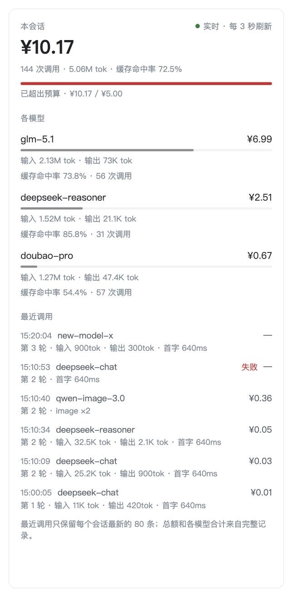
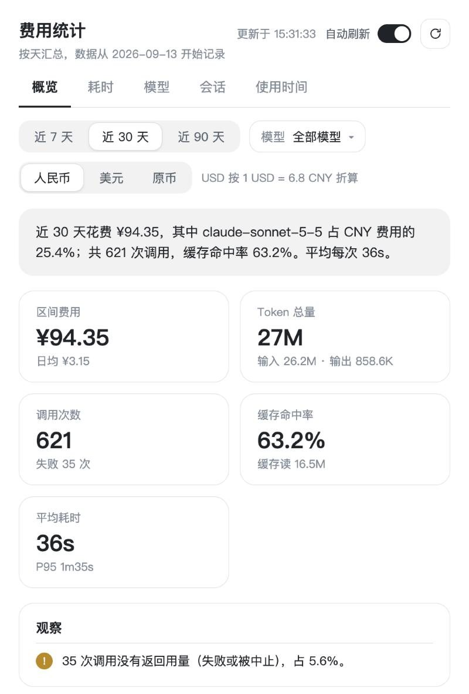
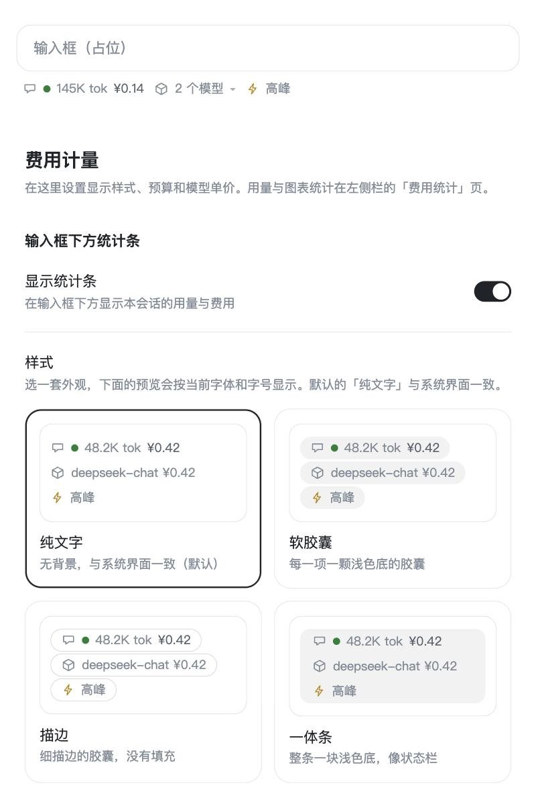

<p align="center">
  
</p>
<h1 align="center">费用计量</h1>
<p align="center">
  <strong>边用边知道：每个会话、每个模型花了多少。</strong><br />
  DeepSeek Harness 插件：按会话与模型统计 token 与费用，在输入框下方和聊天页右侧栏实时显示，并在统计页里画出历史趋势。单价、预算和显示样式都由你设置；所有数据留在你自己的电脑上。
</p>
<p align="center">
  <a href="https://www.npmjs.com/package/@norixor/dsh-cost-meter"></a>
  <a href="#安装与快速开始"></a>
  
  
  <a href="#许可"></a>
</p>
<p align="center">
  <a href="#安装与快速开始">安装</a> ·
  <a href="#主要功能">功能</a> ·
  <a href="#预览">预览</a> ·
  <a href="#多语言">多语言</a> ·
  <a href="#从源码开发">开发</a>
</p>
<p align="center"><a href="README.md">English</a> · 简体中文</p>

## 目录

- [简介](#简介)
- [安装与快速开始](#安装与快速开始)
- [主要功能](#主要功能)
- [预览](#预览)
- [计费口径](#计费口径)
- [图片与语音计量（实验性）](#图片与语音计量实验性)
- [多语言](#多语言)
- [数据与隐私](#数据与隐私)
- [已知限制与验证状态](#已知限制与验证状态)
- [从源码开发](#从源码开发)
- [项目结构](#项目结构)
- [许可](#许可)

## 简介

长时间的智能体会话会在好几个模型之间烧掉大量 token，账单却要事后才看到。费用计量会监听 DeepSeek Harness（DSH）发出的每一次模型调用，在调用结束的那一刻锁定当时的单价，并把累计数字放在你工作的地方：输入框下方、每条助手消息旁、跟随当前会话的侧边栏，以及一个完整的统计页。插件内置 66 个模型的预置价，支持缓存读写计价、上下文分档与峰谷计价，按模型实际结算的币种计费。

## 安装与快速开始

费用计量已发布到 npm，包名 [`@norixor/dsh-cost-meter`](https://www.npmjs.com/package/@norixor/dsh-cost-meter)，同一个包同时适用于两种形态的 DeepSeek Harness：桌面客户端和 DSH Web（`dsh web`）。两种形态各自维护自己的插件列表（即 *profile*），所以在你用的那一种里安装；两种都用就各装一次。

**桌面客户端**

1. 在 DeepSeek Harness 左侧栏打开 **插件**。
2. 点 **添加插件**，在 **包名或地址** 里填入包名 `@norixor/dsh-cost-meter`，点 **安装**。
3. **重启 DeepSeek Harness。**

刚发布新版本时如果找不到这个包，在同一个对话框里展开 **安装源**，选 **npm 官方源**：镜像源可能要隔一阵子才同步。

**DSH Web / 命令行**

```bash
dsh plugin --profile web add @norixor/dsh-cost-meter
```

然后重启 `dsh web`。

左侧栏统计页需要支持「左侧栏插件入口」的 DSH 客户端，右侧栏页签需要带右侧栏页面接口的客户端；客户端较旧时，用不了的功能只是不出现，其余功能照常工作。

升级：先卸载再重新添加。卸载：**插件 →** 本插件 **→ 卸载**（或 `dsh plugin --profile web remove @norixor/dsh-cost-meter`），然后重启。

### 从本地文件夹安装

想试用某个检出版本或自己的改动时用这种方式。**添加插件** 也接受本地文件夹的绝对路径（或点 **添加插件** 右侧的箭头 → **安装第三方插件**）：

1. `git clone https://github.com/Norixor/dsh-cost-meter.git`，放在固定位置，例如 Windows 上的 `D:\dsh-plugins\dsh-cost-meter`。路径里没有空格和中文最稳妥。
2. 在 **插件 → 添加插件** 里填入该文件夹的绝对路径，点 **安装**。
3. **重启 DeepSeek Harness。**

从本地文件夹安装的插件是软链接而不是拷贝：装好之后不要移动或删除这个文件夹。

### 第一次使用

1. 开始一段对话，输入框下方会出现一条统计条：`图标 · 红绿灯 · token 数 · 费用`。
2. 有预置价的模型立刻就能计费。其他模型请打开 **设置 → 费用计量**，在价格表里找到该模型，填每百万 token 的单价；在配价之前发生的调用会补算一次。
3. 可以在同一页设置**会话预算**：费用达到预算的 70 % 变黄灯，达到 100 % 变红灯。
4. 选一个你习惯的费用视图：点输入框下方的模型胶囊并选「在右侧栏打开」，或在右侧栏的 **+** 引导页里选「费用」，或点左侧栏的图表图标进入统计页。

## 主要功能

- **输入框下方统计条。** 当前会话的 token、费用和预算红绿灯。只有一个模型时直接显示模型名；多个模型合并成「n 个模型」，点开浮窗逐个列出 token 构成、缓存命中率、单价（含各分档）和费用。默认样式是纯文字、无背景，与系统界面一致；设置里还可以换软胶囊、描边或一体条。
- **右侧栏实时页签。** 针对当前显示的会话：总费用、调用次数、token 与缓存命中率、预算进度条；下面每个模型一行（费用、占会话的比例、输入 / 输出、缓存命中率、调用次数）；再下面是最近 12 次调用（时间、模型、费用、轮次、token、首字延迟）。页签打开时每 3 秒刷新。
- **每条回复的费用。** 消息操作栏里的小标签和上方的一行摘要显示本轮花费（调用次数 · token · 模型耗时 · 费用）；悬停标签看各模型明细。调用按它开始时所在的轮次归属，所以工具触发的多次调用会算进正确的那条回复。
- **左侧栏统计页**，五个分页：**概览**（一句话结论、指标卡、观察、按模型堆叠的每日费用、费用占比、token 构成）、**耗时**（平均 / P50 / P95、首字延迟、生成速度、分布、最慢的调用）、**模型**（并排对比）、**会话**（可搜索、可排序）、**使用时间**（24 小时分布与星期 × 时段热力图）。可按区间和模型筛选；每张图都有「图表 / 表格」两种视图，深浅主题自动适配。
- **显示币种。** 全部金额可按人民币、美元或原币显示，输入框下方统计条、消息下方标签、侧边栏页和统计页保持一致。折算使用你设置的汇率（默认 1 美元 = 6.8 人民币）；已经是所选币种的金额不折算，已记录的费用也不会被改动。
- **峰谷状态。** 对设置了峰时段的模型（DeepSeek 预置都有），输入框下方统计条默认只显示图标和「高峰 / 低谷」，右侧栏页签显示当前状态和高峰时段（本地时间）。距下一次切换的倒计时，以及右侧栏里的适用工作日、价格倍率、涉及模型和计费规则，都是可选项；每一部分在设置里各有一个开关。
- **单价由你掌握。** 66 个预置模型；每个模型可单独编辑输入、输出、缓存读、缓存写单价；上下文分档；峰谷计价；任意币种的会话预算。
- **导入历史对话。** DSH 自己保存了会话日志。首次启动时，如果有装插件之前的调用，会问一次要不要导入；设置 → 历史导入随时可以手动导入。只读用量（模型、token、时间），不读消息正文；重复导入不会重复计数。
- **图片与语音计量**（实验性，默认关闭），见下文。
- **九种语言**，见[多语言](#多语言)。

## 预览

以下是用示例数据在测试页里渲染的画面；真实客户端里的颜色与字体跟随 DSH 主题。

<table>
  <tr>
    <td align="center" valign="top" width="34%"><br /><sub>右侧栏页签：各模型的实时费用与最近调用</sub></td>
    <td align="center" valign="top" width="66%"><br /><sub>统计页概览：人民币 / 美元 / 原币显示</sub></td>
  </tr>
</table>

<p align="center"><br /><sub>设置页：四套统计条样式，带实时预览，可选字体与字号</sub></p>

## 计费口径

- 一次调用在结束并报告用量时结算，按它开始时的单价和它自己的上下文长度计价；之后改价不会回算历史。
- 单价分三层解析，高层非 0 的项覆盖低层：**峰价 > 分档价 > 基础价**；某层某项留空（0）就沿用下一层。
- **上下文分档。** 一次请求的上下文 = 未命中缓存的输入 + 缓存读 + 缓存写。严格超过某档阈值时，**整次请求**的输入、输出和缓存都按该档单价计；超过多档时取阈值最高的一档。每个模型最多 4 档。
- **峰谷计价。** 最多两段 UTC 高峰时段，可限定工作日；在高峰时段内开始的调用，整次按峰价计。界面上的高峰 / 低谷状态用的是同一组时段，所以显示的就是此刻发起的调用会按什么价计。
- **补算。** 某个模型先被调用、后配价时，配价那一刻会把之前的调用按基础价补算一次；对本来会命中峰价或分档价的调用，这是偏低的估计。
- 同一次调用的流里如果有多个 usage 片段，每个计数取各片段中的最大值。

## 图片与语音计量（实验性）

对话模型直接按 usage 计量；图片生成、语音合成和语音识别是模型调用的**工具**，插件只能在工具调用结束时看到它。所以这里是**按规则计量**，而不是读取厂商账单，默认关闭（设置 → 费用计量 → 图片与语音计量）。

- 一条规则把工具名（精确匹配，或写成 `/正则/`）对应到类型（图片 / 语音合成 / 语音识别）、模型（固定值，或从工具参数里读）、币种和单价。规则按顺序匹配，**第一条命中的生效**，所以具体的放前面、通用的放后面。
- 规则可以带内容条件，例如「仅当参数 `model` 等于 `wan2.6-t2i`」，这样一个背后有多个模型的工具也能按模型分别计价。
- 数量：图片 = 张数参数（没有就按 1 张）；语音合成 = 字数 ÷ 1000；语音识别 = 时长秒数 ÷ 60。读不到数量时记为「未计价」而不是猜；失败的调用不计费。
- 模板覆盖 OpenAI 语音模型、阿里云百炼的 qwen-image / wan 系列，以及最常见的图片模型（gpt-image-2 的低 / 中 / 高三档、gpt-image-2.5-sunburst / -flare、Gemini 的 Nano Banana 系列）。模板下拉里有搜索框：输入几个词，或写成 `/正则/`。OpenAI 的图片模型按 token 计费，所以标 `est.` 的每张价是按 1024² 估算的，请按自己的账单修改。
- 「最近观察到的工具」列出开启计量后见过的工具名和参数名，以及名为 `model`、`model_id`、`model_name`、`engine` 的参数的取值（每个工具最多 8 个）。**不保存提示词或其他内容。**

## 多语言

内置简体中文与 English。随插件附带繁體中文（`zh-hant`）、日本語、한국어、Deutsch、Français、Español、Русский 的词典，以及对应的 `locale/<id>.json` 清单。DSH 自身只提供 `zh` 与 `en`；其他语言需要由语言包插件定义后才会出现在语言选择里，缺少的文案回退到英文。这些译文由机器翻译产出，没有母语者审校。要加一种语言：复制 `src/client/lib/21-locale-en.js` 翻译，在 `29-locales.js` 里登记，加上 `locale/<id>.json`，再跑 `npm test`（会校验键、占位符与清单）。

## 数据与隐私

- 插件不发起任何网络请求。浏览器半部只与 DSH 宿主上仅限本机回环访问的端点（`/__cost-meter`）通信。
- 状态保存在 `~/.dsh/cost-meter.json`（Windows 为 `%USERPROFILE%\.dsh\cost-meter.json`，设置了 `DSH_HOME` 则为 `$DSH_HOME/cost-meter.json`）：累计、会话桶、按天与按小时的桶（最近 90 天）、单价和偏好。删除该文件即重置全部；设置 → 费用计量里的「清空累计」只清累计（单价和预算保留）。
- 为了给消息打标签和驱动右侧栏页签，宿主还会保留最近 20 个会话、每个会话最近 80 次调用的明细（时间、模型、token、已锁定的费用）。不保存提示词或回复内容。
- 按天与按小时的历史从 0.6.0 开始记录，耗时从 0.7.0 开始记录；更早的调用只有累计总数。
- 状态文件旁还有：`cost-meter.json.before-import`（历史导入前的备份）。
- 历史导入读取 `$DSH_HOME/sessions` 下 DSH 的会话日志（只取模型、token 数和时间），且只在你要求时才读。

## 已知限制与验证状态

已检查：单元与集成测试，以及用示例数据在浏览器测试页里渲染每个页面（浅色 / 深色、窄宽度、英文、日文）。

**尚未在真实 DSH 客户端里验证**，因为这些行为是从宿主自带的源码和文档推出来的：

- 右侧栏「费用」页签（登记、打开、拿到的会话 id）；
- 消息下方的费用标签与摘要行（依赖宿主的 `session/event` 事件流与槽位 props；某条消息对不上它的调用时什么都不显示，不会显示错误的数）；
- 图片与语音计量（依赖 `tools/result` 的载荷）；
- 额外语言词典能否通过语言包被选中。

其他限制：

- 会话用「编号 + 主要模型」区分，不显示会话标题：宿主没有给插件读取标题的接口。只保留最近 200 个会话。
- 耗时是在流上测到的墙钟时间（含网络与排队）；P50 / P95 由对数分桶直方图估算。
- 使用时间只统计调用次数和 token，不含费用。
- 分档按整次请求计价，不支持阶梯累进。
- 币种折算只用于显示，汇率是你设的固定值。会话预算仍按预算自己的币种统计（红绿灯用原始金额），只有显示出来的数字会被折算。
- 预置只含有官方依据的分档（Claude Haiku 5.5、gpt-6.1-terra、glm-5.1），其他的请手动添加。
- 历史导入只认 DSH 会话日志的 v4 格式。导入的调用没有耗时，费用按当前单价估算。失败的、标题和联网搜索的调用不在日志里；从别的会话分叉出来的会话会跳过继承来的那一段。如果旧版本插件已经裁剪过某些会话的状态，插件从没见过的会话要先「清空累计」才能导入。

## 从源码开发

插件是没有依赖的纯 JavaScript。`client.js` 是**生成文件**：宿主会把它拼进一个经典 `<script>`，所以必须是单文件，但源码按职责拆在 `src/client/`（`lib/` 是工厂作用域，`apply/` 是 `apply(ctx)` 的内容）。开发与测试环境为 Node.js 24。

```sh
npm run build   # 由 src/client 重新生成 client.js
npm test        # 先校验 client.js 是最新的，再跑全部测试
```

不装 DSH 想试一下：把 `client.js` 加载进一个提供 `window.__ModuleLoader__`、React 18 以及假的 `slots` / `locale` 服务的页面，`test/client.test.mjs` 里有所需的最小宿主。

## 项目结构

```text
index.js, pricing.js, daily.js,   Host 半部：llm/stream 钩子、端点、计价规则、按天桶、
timing.js, calllog.js, media.js,  耗时、调用日志、媒体规则、偏好、预置价
prefs.js, presets.js, route-security.js
history.js                        历史导入：读 DSH 会话日志里的用量
client.js                         生成的浏览器半部（不要直接改）
src/client/lib/                   界面、统计与译文，按文件名顺序拼接
src/client/apply/                 槽位登记（apply(ctx)）
locale/*.json                     各语言的插件标题与描述
test/                             node:test 测试与假宿主
scripts/                          build-client.mjs、sync-windows.sh（可选辅助脚本）
docs/images/                      README 截图
HANDOFF.md                        维护者笔记：关键语义、已验证 / 未验证项
```

## 许可

MIT，见 [LICENSE](LICENSE)。预置价来自 Anthropic 与 OpenAI 官方定价页（2026-10-23 核对）和其他厂商的公开页面；国产权重模型沿用 model-usage-plugin 的预设值。价格会变，请以你自己的账单为准。
